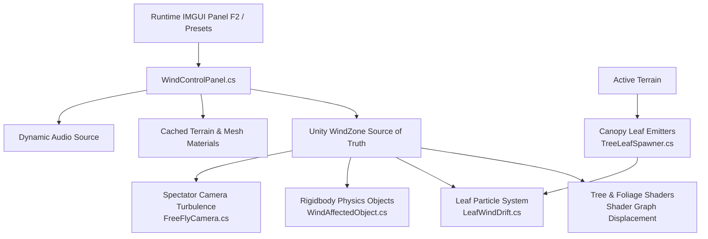

# 🍃 Unity Wind Physics Simulation

[](https://unity.com/)
[](https://unity.com/)
[](https://unity.com/features/shader-graph)
[](https://docs.unity3d.com/Manual/PhysicsOverview.html)
[](LICENSE)

An atmospheric, physically integrated environmental wind simulation built for Unity utilizing the Universal Render Pipeline (URP). This project features a unified wind architecture that simultaneously coordinates GPU vertex displacement (trees, foliage, grass), particle dynamics (falling leaf drift & canopy spawning), rigid-body physics push, dynamic audio transitions, and spectator camera turbulence.

Developed by **Saurav**.

---

## 📑 Table of Contents

- [Overview & Architecture](#-overview--architecture)
- [Key Features](#-key-features)
- [System Breakdown](#-system-breakdown)
  - [1. Master Wind Controller & IMGUI Runtime Panel](#1-master-wind-controller--imgui-runtime-panel)
  - [2. Shader-Based Foliage & Tree Sway](#2-shader-based-foliage--tree-sway)
  - [3. Leaf Particle Dynamics & Canopy Spawner](#3-leaf-particle-dynamics--canopy-spawner)
  - [4. Rigidbody Wind Physics Interaction](#4-rigidbody-wind-physics-interaction)
  - [5. Atmospheric Free-Fly Spectator Camera](#5-atmospheric-free-fly-spectator-camera)
  - [6. Dynamic Audio Ambiance](#6-dynamic-audio-ambiance)
- [Mathematical & Physics Formulations](#-mathematical--physics-formulations)
- [Key Engineering Challenges & Solutions](#-key-engineering-challenges--solutions)
- [Project Directory Structure](#-project-directory-structure)
- [Controls & Usage](#-controls--usage)
- [Getting Started](#-getting-started)
- [Credits & Tech Stack](#-credits--tech-stack)

---

## 🌪 Overview & Architecture

In realistic outdoor simulations, wind cannot act as an isolated visual effect; it must be cohesive across rendering, physics, audio, and player perception.

The **Unity Wind Physics Simulation** establishes a single centralized source of truth—the `WindZone` combined with `WindControlPanel`—which broadcasts live simulation parameters across multiple subsystems in real time:



---

## ✨ Key Features

- **Unified Environmental Synchronisation**: Wind direction, strength, speed, gusts, and turbulence directly drive tree vertex animation, grass flutter, particle drift, physics forces, and spectator camera wobble in unison.
- **Interactive Runtime Control Panel**: Toggleable debug/control interface (`F2`) with real-time sliders, numeric buffers, 8-point compass bearing, and one-click weather presets (**Calm**, **Breeze**, **Windy**, **Storm**).
- **Frame-Rate Independent Transitions**: Smooth exponential damping algorithm ensures gradual weather state transitions regardless of rendering framerate.
- **Shader Graph Vertex Animation**: Synchronized vertex displacement for branches and motion-vector-driven bark flex without mesh distortions.
- **Optimized Canopy Leaf Spawning**: Automated terrain parsing places leaf particle emitters on pine tree canopies, complete with distance-based culling (`activeDistance`) and throttled updates.
- **PhysX RigidBody Wind Force**: Dynamic directional force applied continuously in `FixedUpdate` with custom mass/drag scaling.
- **Dynamic Spectator Camera Dynamics**: Full 6-DOF free-flight camera influenced by directional tilt, Perlin noise turbulence, downwind velocity push, and wind pulse waves.

---

## 🛠 System Breakdown

### 1. Master Wind Controller & IMGUI Runtime Panel
**Script:** [`WindControlPanel.cs`](Assets/Scripts/WindControlPanel.cs)

Acts as the central orchestrator. At startup (`Start` & `BuildMaterialBindings`), it scans all active terrains, tree prototypes, detail meshes, and scene renderers to discover materials containing wind property IDs.
- **Zero Runtime Allocations**: Shader property names are pre-hashed using `Shader.PropertyToID` to avoid runtime string lookups.
- **Weather Presets**:
  | Preset | Strength | Speed | Intensity | Turbulence | Gust Pulse |
  | :--- | :---: | :---: | :---: | :---: | :---: |
  | **Calm** | `0.5` | `1.0` | `0.03` | `0.05` | `0.1` |
  | **Breeze** | `2.0` | `2.0` | `0.04` | `0.20` | `0.3` |
  | **Windy** | `5.0` | `4.0` | `0.05` | `0.40` | `0.7` |
  | **Storm** | `10.0` | `7.0` | `0.08` | `0.80` | `1.4` |
- **Compass Calculation**: Dynamically maps 0–360° heading to 8 compass points (N, NE, E, SE, S, SW, W, NW).

---

### 2. Shader-Based Foliage & Tree Sway
**Shader:** [`Wind.shadergraph`](Assets/Shader/Wind.shadergraph)

Created in Shader Graph to displace geometry along vertex normals and motion vectors:
- **Branches**: Vertex positions are perturbed in object space scaled by dynamic wind amplitude and turbulence.
- **Bark**: Motion vectors are utilized instead of raw vertex positions to prevent unnatural scaling or deformation of 2D bark textures.
- **Grass Linking**: Grass intensity and detail sways dynamically scale with `strength / strengthReference`, creating harmonized environmental motion during squalls and storms.

---

### 3. Leaf Particle Dynamics & Canopy Spawner
**Scripts:** [`LeafWindDrift.cs`](Assets/Scripts/LeafWindDrift.cs), [`TreeLeafSpawner.cs`](Assets/Scripts/TreeLeafSpawner.cs)

- **`LeafWindDrift.cs`**:
  - Direct integration with Unity's `ParticleSystem` External Forces module.
  - Dynamically scales emission rate from wind velocity; disables emission during calm periods to preserve CPU/GPU cycles.
  - Generates realistic tumbling through randomized angular velocities ($\pm \text{spin}$) and low-frequency noise flutter.
  - Hard cap of 40 particles per emitter to ensure low memory footprint.
- **`TreeLeafSpawner.cs`**:
  - Automatically identifies terrain tree instances filtered by prototype (e.g. Pine trees).
  - Estimates prototype heights using mesh bounding boxes to position emitters accurately in tree canopies.
  - Uses a seeded `System.Random` shuffle to distribute emitters evenly across the terrain.
  - **Distance Culling**: Emitters beyond `activeDistance` (150m) are disabled via squared distance checks, throttled to every 0.5s.

---

### 4. Rigidbody Wind Physics Interaction
**Script:** [`WindAffectedObject.cs`](Assets/Scripts/WindAffectedObject.cs)

Applies physical aerodynamics to interactive objects (crates, debris, physical spheres):
- Applied continuously inside `FixedUpdate` using `ForceMode.Force`.
- Direction is sourced from the `WindZone.transform.forward` vector, with magnitude scaled by `windMain` and a customizable per-object `forceMultiplier`.
- Objects roll, slide, and collide naturally according to mass, friction, and wind resistance.

---

### 5. Atmospheric Free-Fly Spectator Camera
**Script:** [`FreeFlyCamera.cs`](Assets/Scripts/Freeflycamera.cs)

Provides full spectator navigation with physically reactive wind responses:
- **Flight Controls**: Smooth WASD movement, Sprint (`Shift`), Slow (`Ctrl`), and mouse-wheel speed adjustments ($1\text{ m/s}$ to $300\text{ m/s}$).
- **Wind Tilt (Roll/Pitch)**: Tilts away from crosswinds and dips/lifts into headwinds/tailwinds.
- **Perlin Turbulence**: High-frequency procedural camera shake simulating atmospheric buffeting during heavy winds.
- **Downwind Drift**: Applies physical drift velocity downwind unless `stableCamera` mode is activated.
- **Multi-Input Compatibility**: Supports both Unity's New Input System (`UnityEngine.InputSystem`) and Legacy Input Manager via compiler directives.

---

### 6. Dynamic Audio Ambiance
Ambient soundscapes switch automatically when selecting weather presets:
- **Calm**: Gentle distant nature and faint rustling.
- **Breeze**: Soft leaves rustling and mild wind flow.
- **Windy**: Pronounced wind gusts rushing across the landscape.
- **Storm**: Heavy gale-force squalls and howling winds.

---

## 📐 Mathematical & Physics Formulations

### 1. Frame-Rate Independent Exponential Smoothing
To avoid inconsistent Lerp smoothing rates across varying frame rates (30 FPS vs 144 FPS), state smoothing uses:
$$k = 1 - e^{-\frac{\Delta t}{\tau}}$$
*Where $\tau$ is `smoothTime` and $\Delta t$ is `Time.deltaTime`.*

### 2. Tree Wind Multiplier
To ensure violent storms flex tree trunks and branches realistically:
$$\text{Multiplier} = 1 + (\text{Strength} \times 0.4) + (\text{Turbulence} \times 1.5)$$

### 3. Grass-to-Wind Intensity Ratio
$$\text{Link} = \frac{\text{Strength}}{\max(0.01, \text{StrengthReference})}$$
*(The $\max(0.01, \dots)$ operation safeguards against division-by-zero).*

### 4. Continuous Physics Force Calculation
$$\vec{F}_{\text{wind}} = \vec{D}_{\text{forward}} \times \text{windMain} \times \text{forceMultiplier}$$
*Applied in `FixedUpdate` using `rb.AddForce(windForce, ForceMode.Force)`.*

### 5. Leaf Emission Rate
$$\text{Rate} = \text{baseLeavesPerSecond} \times \max(1, \text{windMain} \times 0.2)$$

### 6. Camera Turbulence & Pulse Equations
$$\text{Pulse} = 1 + \text{Magnitude} \times \sin(t \times \text{Frequency} \times 2\pi)$$
$$\text{Noise} = \left(\text{Perlin}(t \times \text{speed}, \text{seed}) - 0.5\right) \times 2 \times \text{amplitude}$$
$$\text{Effect} = \left(\frac{\text{WindStrength}}{\text{MaxStrength}}\right)^2$$
*(Quadratic power curve ensures gentle breezes remain subtle while high-tier storms produce intense camera buffeting).*

---

## 💡 Key Engineering Challenges & Solutions

### 1. Desynchronization of Branch & Bark Shaders
- **Problem**: When animating trees in Shader Graph, branch materials and trunk bark materials flexed at disparate speeds and amplitudes. Because bark is a 2D planar wrapped texture, applying object-space vertex displacement directly doubled the visual scale of the tree trunk.
- **Solution**: 
  - Branches use float multiplication against animated vertex object-space positions added to the base position.
  - Bark displacement replaces object-space vertex offsets with **object-space motion vectors**, bringing the bark and branch motion into perfect visual unison without mesh distortion.

### 2. Large-Scale Terrain Performance
- **Problem**: Querying thousands of terrain trees and updating hundreds of materials every frame caused CPU overhead.
- **Solution**:
  - Pre-hashed shader property IDs via `Shader.PropertyToID` during `Start()`.
  - Leaf emitters execute distance-based squared magnitude culling (`sqrMagnitude <= activeDistance^2`), skipping expensive square-root operations.
  - Update loops for particle culling throttled to 2 Hz (every `0.5s`) rather than running per-frame.

---

## 📁 Project Directory Structure

```
Assets/
├── Prefab/
│   ├── Ball.prefab                     # Sample physics-enabled sphere
│   └── Leaves Particles.prefab         # Falling leaves emitter prefab
├── Resources/                          # Runtime resources
├── Scenes/
│   └── SampleScene.unity               # Showcase terrain & demonstration environment
├── Scripts/
│   ├── Freeflycamera.cs                # 6-DOF spectator camera with wind tilt & drift
│   ├── LeafWindDrift.cs                # Particle system wind integration
│   ├── TreeLeafSpawner.cs              # Terrain canopy emitter manager & culling
│   ├── WindAffectedObject.cs           # Rigidbody wind aerodynamic force
│   └── WindControlPanel.cs             # IMGUI controller & shader parameter bridge
├── Shader/
│   ├── Wind.mat                        # Showcase wind material
│   └── Wind.shadergraph                # URP vertex displacement wind shader
├── Sounds/                             # Preset ambient audio tracks (.mp3)
├── TerrainDemoScene_URP/               # High-fidelity URP terrain assets & data
└── TerrainLayer/                       # Terrain texturing & layers
```

---

## 🎮 Controls & Usage

| Input | Action |
| :--- | :--- |
| <kbd>F2</kbd> | Toggle the **Wind Control Panel** (GUI) |
| <kbd>Right Mouse Button</kbd> (Hold) | Engage spectator camera look |
| <kbd>W</kbd> <kbd>A</kbd> <kbd>S</kbd> <kbd>D</kbd> | Fly camera movement |
| <kbd>Shift</kbd> (Hold) | Sprint multiplier ($3\times$ speed) |
| <kbd>Ctrl</kbd> (Hold) | Slow precision movement ($0.25\times$ speed) |
| <kbd>Mouse Scroll Wheel</kbd> | Adjust flight speed dynamically ($1 - 300\text{ m/s}$) |

---

## 🚀 Getting Started

1. **Clone the Repository**:
   ```bash
   git clone https://github.com/SV-Gdev/Wind-Physics-Simulation.git
   ```
2. **Git LFS**:
   Ensure Git LFS is installed and pulled before opening the project:
   ```bash
   git lfs install
   git lfs pull
   ```
3. **Open in Unity**:
   - Open **Unity Hub** and select **Add Project from Disk**.
   - Compatible with **Unity 2022.3 LTS**, **Unity 6**, and Universal Render Pipeline (URP).
4. **Load the Scene**:
   - Navigate to [`Assets/Scenes/SampleScene.unity`](Assets/Scenes/SampleScene.unity) and press **Play**.
   - Press <kbd>F2</kbd> to explore different wind presets and manipulate environmental parameters live!

---

## 📜 License & Credits

- Developed by **Saurav**
- Ambient audio samples sourced from Freesound Community
- Released under the [MIT License](LICENSE)
